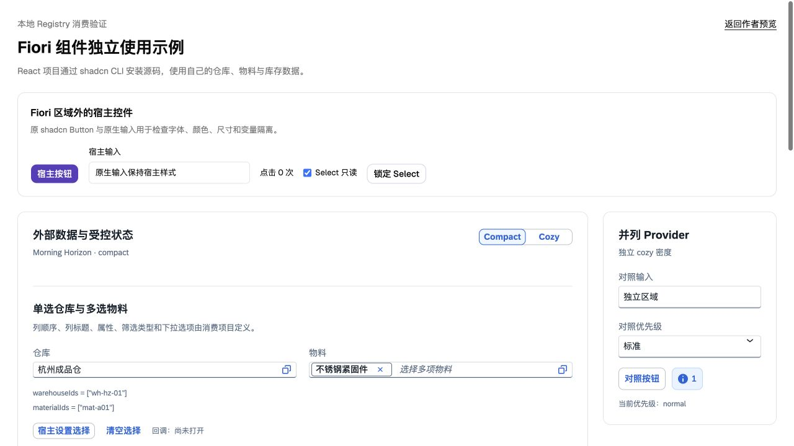

# Fiori · shadcn · Base UI

基于 React、shadcn 与 Base UI 的 SAP Fiori 高保真原型和组件库试产。以官方 Fiori guideline 与 UI5 sample 为对照，验证外观、密度、键盘与焦点行为，再提炼可复制安装的 React 组件。

页面和组件交互由 React 与 Base UI 实现，没有引入 UI5/SAPUI5 控件运行时。SAP 资源用于静态字体、图标、主题参数和 sample 图片，来源与许可见 [第三方声明](./THIRD_PARTY_NOTICES.md)。

当前范围为 Morning Horizon 明亮主题：Button、Input、Select、MessageStrip、Value Help 单选/多选、独立条件字段、MessagePopover，以及 `FioriProvider` 和隔离主题。List Report 与 Object Page 用于对照和演示，尚未提炼成可分发页面模板。



## 两个独立项目

```text
fiori-shadcn-baseui/
├── fiori-design-lab/         原型、组件源码、Registry 和验证记录
└── fiori-registry-consumer/  通过 shadcn CLI 安装的独立消费示例
```

两端各自维护依赖和锁文件。消费示例没有 alias 或 symlink 回作者源码，使用调用方自己的仓库、物料和库存数据。

需要 Node.js **22.12.0 或更新版本**及 npm，CI 使用 Node.js 24。在仓库根目录安装两端依赖：

```bash
npm --prefix fiori-design-lab ci
npm --prefix fiori-registry-consumer ci
```

启动设计实验室：

```bash
npm run dev:lab
```

在另一终端启动消费示例：

```bash
npm run dev:consumer
```

| 项目 | 开发地址 | 生产预览地址 |
| --- | --- | --- |
| 设计实验室 | [127.0.0.1:5178](http://127.0.0.1:5178/) | [127.0.0.1:4178](http://127.0.0.1:4178/) |
| 消费示例 | [127.0.0.1:5188](http://127.0.0.1:5188/) | [127.0.0.1:4188](http://127.0.0.1:4188/) |

实验室入口：`/#/orders`、`/#/orders/PO-48865`、`/#/components`、`/#/verification`。端口固定且仅绑定本机。

生产预览前先构建：

```bash
npm run build
npm run preview:lab
```

消费端预览在另一终端执行 `npm run preview:consumer`。构建结果需要通过 HTTP 服务访问。

## Registry 安装

本地 Registry 有10个条目，组合入口 `@fiori/fiori-kit` 安装37个源码、CSS和许可文件。先构建并启动实验室的4178预览服务，在目标 shadcn 项目的 `components.json` 中加入：

```json
{
  "registries": {
    "@fiori": "http://127.0.0.1:4178/r/{name}.json"
  }
}
```

首次安装：

```bash
npx shadcn@latest add @fiori/fiori-kit
```

已有安装更新前用 `--dry-run` 和 `--diff` 审查目标文件及本地修改。安装后的组件运行不依赖 Registry 服务。完整配置、目标映射和更新步骤见 [Registry 文档](./fiori-design-lab/docs/registry.md)。

## API 与验证

- [组件契约](./fiori-design-lab/docs/component-contracts.md)：受控状态、密度、键盘、焦点与主题隔离。
- [Value Help API](./fiori-design-lab/docs/value-help-api.md)：外部目录、列、筛选、单选/多选与条件字段。
- [消息 API](./fiori-design-lab/docs/messages-api.md)：外部消息、分类、详情与字段定位。
- [QA 记录](./fiori-design-lab/QA.md)：官方对照、截图、浏览器步骤与结果。
- [消费和设备验收](./fiori-design-lab/docs/consumer-validation.md)：可重复操作与尚未执行的设备检查。

在安装两端依赖后执行：

```bash
npm run verify
```

这会检查两端 lint/build、主题和 Registry 生成一致性、9项目录/条件契约测试及消费源码闭包。Actions 执行相同的源码检查。

本轮已完成桌面和390×844浏览器交互回归；axe 4.14.0 对桌面、手机普通页及手机 Value Help 复扫未报告违规，未判定项另有颜色和键盘复核。真实触屏、软键盘、Safari/VoiceOver尚未执行；以上结果不等同完整无障碍认证或全部 Fiori 变体一致性。

## 参考与当前边界

- [SAP Fiori for Web v1-151](https://www.sap.com/design-system/fiori-design-web/v1-151/discover/get-started)
- [List Report guideline](https://www.sap.com/design-system/fiori-design-web/v1-151/page-types/floorplans/list-report-floorplan-sap-fiori-element)
- [ObjectPageSectionShowTitle sample](https://openui5nightly.hana.ondemand.com/#/entity/sap.uxap.HeaderFacetPattern/sample/sap.uxap.sample.ObjectPageSectionShowTitle)
- [SAP Fiori Community UI Kit](https://www.figma.com/community/file/1494295794601744471)

对象页以本轮读取的 OpenUI5 nightly **1.155.0-SNAPSHOT**为行为对照，设计规范为 **v1-151**；两者版本体系不同，nightly在线内容会变化。来源索引和实现说明保留在实验室 `references/`，完整UI5源码快照不随本仓库分发。

当前为前端试产，无OData/后端、完整UI5 API、暗色/高对比度主题或正式跨项目版本承诺。GitHub仓库分发源码；尚未部署公网Registry、GitHub Pages或发布npm包。更细的样本边界见 [实验室 README](./fiori-design-lab/README.md) 与 [消费示例 README](./fiori-registry-consumer/README.md)。
